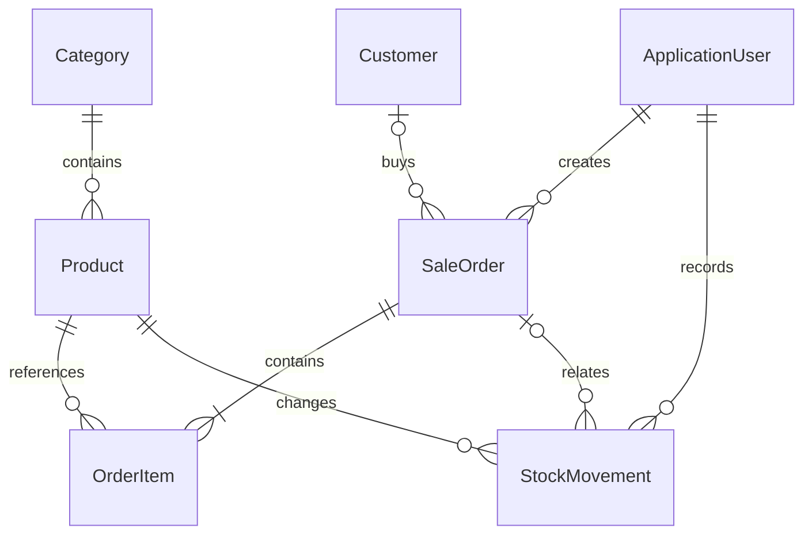

# ShopManager — Đặc tả phiên bản 1

Ngày: 06/11/2026. Mục đích: dự án cá nhân fullstack C# để học nghiệp vụ, trình diễn và đưa vào CV. Phạm vi: một cửa hàng, một kho, tiền VND, bán hàng thanh toán tiền mặt ngay. Không tích hợp AI, cổng thanh toán, vận chuyển, công nợ hay giá vốn/lợi nhuận.

## 1. Vai trò

| Chức năng | Quản lý (Manager) | Nhân viên (Staff) |
|---|---|---|
| Đăng nhập, đổi mật khẩu, đăng xuất | Có | Có |
| Xem/tìm sản phẩm, tồn kho | Có | Có |
| Tạo/sửa danh mục, sản phẩm, ngừng bán | Có | Không |
| Nhập kho và xem sổ kho | Có | Không |
| Tạo/sửa/tìm khách hàng | Có | Có |
| Tạo đơn, xem/in đơn của mình | Có | Có |
| Xem tất cả đơn, hủy đơn | Có | Không |
| Báo cáo, tạo/khóa tài khoản nhân viên | Có | Không |

Quyền được kiểm tra tại server. Không cung cấp đăng ký công khai. Quản lý đầu tiên tạo từ biến môi trường khi khởi tạo dữ liệu. Nhân viên do quản lý tạo, không thể tự nâng quyền.

## 2. Luồng nghiệp vụ

### Sản phẩm và kho
Sản phẩm gồm SKU duy nhất, tên, danh mục, giá bán nguyên đồng, mức cảnh báo tồn, trạng thái kinh doanh. Tồn ban đầu bằng 0. Tồn chỉ thay đổi qua nhập kho, bán hàng hoặc hủy đơn. Ngừng bán giữ nguyên lịch sử; danh mục và khách hàng không xóa trong bản đầu.

Nhập kho: quản lý chọn sản phẩm, số lượng nguyên dương, ghi chú. Server tăng tồn và thêm StockMovement trong cùng giao dịch. Chống gửi lặp bằng mã thao tác duy nhất. Nhật ký ghi người thực hiện, thời gian UTC và số lượng tăng/giảm.

### Bán hàng
1. Nhân viên tìm sản phẩm còn bán và còn hàng, thêm vào giỏ.
2. Chọn khách hàng hoặc khách vãng lai; nhập tiền khách đưa.
3. Server kiểm tra giỏ không rỗng, số lượng hợp lệ, sản phẩm tồn tại/còn bán, số tồn và tiền khách đưa đủ.
4. Đơn giá/tổng tiền lấy và tính tại server, bỏ qua giá phía trình duyệt.
5. Tạo đơn Completed, chi tiết và biến động kho; trừ tồn trong cùng transaction.
6. Chuyển đến hóa đơn; hiển thị tiền thừa và cho phép in qua trình duyệt.

Mỗi yêu cầu có mã duy nhất để nhấn xác nhận lặp không tạo hai đơn. Nếu giá hoặc hàng thay đổi trong quá trình bán, server kiểm tra lại và báo lỗi để người bán xác nhận lại.

### Hủy đơn
Chỉ quản lý; bắt buộc lý do. Chỉ đơn Completed được hủy. Hoàn lại tồn và ghi StockMovement cùng transaction chuyển trạng thái Cancelled, lưu người/thời gian/lý do hủy. Không được hoàn hai lần. Không có hủy một phần hoặc trả hàng một phần trong phiên bản 1. Việc hoàn tiền mặt được xử lý bên ngoài ứng dụng; trạng thái hủy không tự thực hiện chuyển tiền.

### Báo cáo
Khoảng ngày theo giờ Việt Nam (UTC+7); lưu mốc thời gian UTC. Doanh thu tính tổng đơn Completed trong khoảng ngày tạo đơn, loại đơn đã hủy. Có số đơn, giá trị trung bình, doanh thu theo ngày, top sản phẩm theo số lượng và cảnh báo tồn. Hủy đơn cũ làm thay đổi báo cáo kỳ cũ; đây không phải sổ kế toán dòng tiền. Không tuyên bố lợi nhuận.

## 3. Thiết kế dữ liệu

- Category: Id, Name (unique).
- Product: Id, Sku (unique), Name, CategoryId, Price decimal(18,0), Stock int >= 0, LowStockThreshold, IsActive, RowVersion.
- Customer: Id, Name, Phone, Address; số điện thoại không dùng làm khóa duy nhất.
- ApplicationUser: ASP.NET Core Identity, FullName, IsActive; vai trò Manager/Staff.
- SaleOrder: Id, RequestId (unique), CreatedAt UTC, CreatedById, CustomerId nullable, CustomerName/Phone snapshot, Total, CashReceived, Status, CancelledAt/ById/Reason, RowVersion.
- OrderItem: Id, SaleOrderId, ProductId, Sku/Name snapshot, UnitPrice, Quantity. Giá dòng = UnitPrice * Quantity.
- StockMovement: Id, ProductId, Delta, Type (Receipt/Sale/Cancellation), Note, CreatedAt UTC, CreatedById, SaleOrderId nullable, RequestId nullable unique có filter.

Tiền dùng decimal, không dùng float. Dùng SQL Server rowversion cho Product và SaleOrder để phát hiện thay đổi đồng thời. Giao dịch thất bại rollback toàn bộ; hiển thị thông báo yêu cầu tải lại, không âm thầm ghi đè. Không cascade delete dữ liệu nghiệp vụ. Chỉ trường ViewModel cho phép mới được bind khi ghi dữ liệu.

## 4. Kiến trúc và giao diện

.NET 10, ASP.NET Core MVC, Razor Views, Bootstrap 5, JavaScript, EF Core 10, SQL Server, ASP.NET Core Identity. Một ứng dụng triển khai, chia Controllers / Models / ViewModels / Services / Data / Views; không thêm tầng repository bọc EF không cần thiết.

Các màn hình: đăng nhập, tổng quan, sản phẩm (tìm kiếm/phân trang/thêm/sửa), danh mục, khách hàng (tìm kiếm/phân trang/thêm/sửa), bán hàng, danh sách đơn (tìm kiếm/phân trang/lọc trạng thái), hóa đơn, nhập kho/sổ kho, tài khoản nhân viên, đổi mật khẩu. Giao diện tiếng Việt, responsive, có trạng thái trống và lỗi validation; thao tác ghi dùng POST + anti-forgery.

## 5. Bảo mật và vận hành

- Cookie HttpOnly, xác thực Identity với băm mật khẩu, khóa tạm khi đăng nhập sai nhiều lần.
- HTTPS/HSTS ở môi trường production; preview chỉ bind localhost.
- Không lưu mật khẩu/secret thật vào Git. Tài khoản ban đầu nhận qua biến môi trường.
- Khóa nhân viên vô hiệu phiên đăng nhập hiện tại qua kiểm tra tài khoản khi xác thực cookie.
- EF migrations tạo database riêng ShopManager, không sửa database có sẵn khác. Seed mẫu là thao tác tường minh, không tự chạy trên production.
- Xử lý lỗi thân thiện; log server không chứa mật khẩu.

## 6. Tiêu chí nghiệm thu

1. Hai vai trò đăng nhập và quyền đúng, Staff không truy cập dữ liệu đơn của người khác.
2. Tạo sản phẩm SKU trùng bị từ chối; tìm kiếm/phân trang hoạt động.
3. Nhập 10 rồi bán 3 còn 7; hóa đơn giữ giá cũ sau khi giá sản phẩm đổi.
4. Bán quá tồn, số lượng âm/0, giỏ rỗng hoặc tiền thiếu đều bị chặn.
5. Một dòng không hợp lệ khiến toàn bộ đơn không được tạo, tồn không bị trừ dở.
6. Hai giao dịch tranh chấp hàng cuối cùng không thể cùng thành công gây âm kho.
7. Hủy đơn hoàn tồn đúng một lần; gửi lại cùng mã tạo đơn/nhập kho không nhân đôi.
8. Báo cáo không tính đơn hủy; lọc ngày đúng giờ Việt Nam.
9. Kiểm thử nghiệp vụ xUnit + SQL Server integration; smoke test HTTP các trang và quyền; kiểm tra giao diện nếu công cụ trình duyệt khả dụng.
10. README có cách chạy, ERD, quy trình demo, giới hạn và kết quả kiểm thử thực tế.

## 7. Lộ trình

Đặc tả → Models/DbContext/Identity/migration → danh mục/sản phẩm/khách hàng → kho → bán/hủy đơn → báo cáo và quản lý nhân viên → kiểm thử, hướng dẫn và demo. Bản bàn giao là dự án cá nhân, chưa tuyên bố đã triển khai cho cửa hàng thật.
